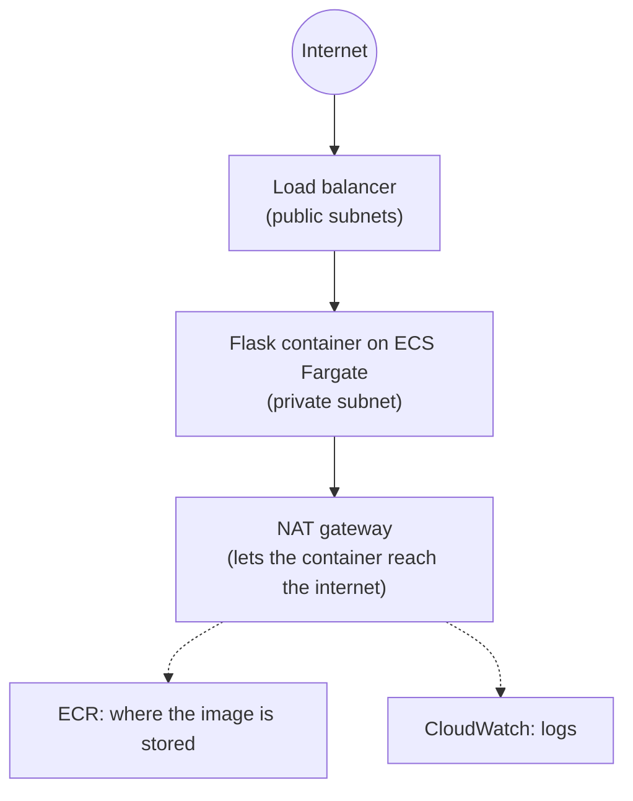

# CloudOps Launchpad

My cloud and DevOps learning project. It's a small Python (Flask) API that runs in a container on AWS. I built the whole setup with Terraform, and a GitHub Actions pipeline deploys it.

The API is tiny on purpose (`/health` and `/`). The goal was to learn everything around it: networking, containers, infrastructure as code, CI/CD, and fixing things when they break.

## What it does

- Runs a Flask API in a Docker container on **AWS ECS Fargate** (no servers to manage)
- Puts a **load balancer** in front of it, so the container itself stays private
- Builds all the AWS parts with **Terraform**
- Deploys with **GitHub Actions**, without storing any AWS password or key
- Checks my Terraform on every pull request (formatting, validation, and a Checkov security scan)
- Sends me an email if the load balancer reports an unhealthy container, and rolls back a deployment that can't start

## Architecture



In words:

- One **VPC** with 2 availability zones. Each zone has a public and a private subnet.
- The **load balancer** is the only thing the internet can reach.
- The **container** lives in a private subnet. A security group only lets the load balancer talk to it.
- A **NAT gateway** lets the container go out to download its image and send logs, but nobody can come in through it.
- The load balancer checks `/health` every 30 seconds and only sends traffic to a healthy container.

## How the pipeline works

1. I start the **Deploy** workflow on GitHub.
2. GitHub proves who it is to AWS with a short-lived token (**OIDC**), and AWS gives back temporary credentials.
3. The workflow builds the Docker image and pushes it to ECR.
4. It tells ECS to start new containers with the new image and waits until they are healthy.
5. A **smoke test** (`scripts/smoke_test.py`) calls the live `/health` and fails the run if the app isn't answering correctly.

I run `terraform apply` by hand on purpose, so I decide when the paid resources exist.

## Safety nets

- **Circuit breaker with rollback** on the ECS service: if a new version can't start, ECS stops the deployment and goes back to the last good one.
- **CloudWatch alarm** on the load balancer's unhealthy target count. It sends an email through SNS. When the platform is off there is no data, and the alarm treats that as fine, so it stays quiet.

## Security

- No AWS keys stored anywhere. GitHub uses OIDC and gets temporary credentials.
- The deploy role only works for **this repo** and the **main** branch.
- The role can only do what the pipeline needs: push to one ECR repo, update one ECS service, and find the load balancer.
- The container runs as a normal user (not root) and has no public IP.
- Terraform state is stored in S3 with versioning, encryption, and locking.
- Budget alert, MFA on my accounts, and no IAM access keys.
- My email for alerts is kept out of the repo (git-ignored `terraform.tfvars`).

## Cost

The paid parts are the load balancer, the NAT gateway, the Elastic IP, and the Fargate task. I only create them for a test session and destroy them right after:

```
terraform destroy -target=aws_lb.app_lb -target=aws_eip.eip
```

My estimate from AWS's published prices is about 10 cents per hour while they exist. That's an estimate, not a real bill.

## Checkov (security scan)

First scan: **69 passed, 23 failed**.

- I fixed the **7** that were free and changed nothing (descriptions on rules, ECR scan on push, locking the default security group, dropping invalid headers).
- I **accepted the other 16** on purpose and wrote the reasons in the workflow file. Most are because I have no domain (so no HTTPS), or because the fix costs money (WAF, flow logs, KMS keys), or would break how I work (deletion protection stops my `destroy`).

After that: **76 passed, 16 accepted**.

## Live test

I rebuilt the platform from the final Terraform and tested everything on it:

- [x] **Platform up:** 8 resources added and 5 changed, no errors, including the new alarm.
- [x] **Deploy workflow:** run #10 passed in about 3 minutes, and the smoke test printed `PASS` against the new load balancer.
- [x] **Alarm:** created, state `OK`.
- [x] **Broke the health check on purpose:** the target became unhealthy, the alarm went to `ALARM`, and the **email arrived about 5 minutes after the change**.
- [x] **Broke the image tag on purpose** (a tag that doesn't exist): ECS tried three times, the circuit breaker marked the deployment failed (3 of 3 failed tasks) and **rolled back to the last good version** about 15 minutes after the start. The site kept answering `200` the whole time.
- [x] **Destroyed** the 7 paid resources, and the console was clear.

## Things that broke (and what I learned)

- **Wrong health check path:** the load balancer marked the container unhealthy and ECS kept replacing it. The reason (`404`) was in the target's status and in the app logs.
- **Bad image tag:** the first time (circuit breaker off), `terraform apply` said success but the new container never started and ECS retried forever. With the circuit breaker on, it stopped and rolled back. A green apply doesn't mean a working deploy.
- **A rollback needs the old version to still exist.** Terraform deregisters the old task definition when it replaces it. I set `skip_destroy = true` so old versions stay active. I did this because AWS says inactive versions can't start new tasks, but I did not test it without.
- **After a rollback, Terraform's state is out of date.** It still thinks the bad version is deployed, so the next `plan` shows a change. That's expected.
- **OIDC login refused:** GitHub had changed the `sub` in its token to include numeric IDs, so my role's rule didn't match. I printed the token in a workflow step and compared it with my rule.
- **`403 Forbidden` when pushing the image:** my role was missing two read permissions for ECR.
- **Docker login to ECR failed on Windows:** fixed with the Amazon ECR credential helper.
- **Checkov wouldn't install on my machine:** I ran it in GitHub Actions instead.

## What isn't done yet

- **HTTPS.** It needs a domain and a certificate.
- **Branch protection**, so a failing check blocks a merge.
- **One container and one NAT gateway only** (cheaper, but not highly available).
- **The `latest` tag moves**, so a rollback restores the old deployment settings but they still point at `latest`. Better: deploy by commit id.
- **Health check grace period is 0 seconds**, so ECS can replace a container that is still starting.
- No modules, and no separate dev and prod.

## Folders

```
bootstrap/   creates the S3 bucket for Terraform state
infra/       the whole platform in Terraform
app/         the Flask API and its Dockerfile
scripts/     smoke_test.py, used by the pipeline
.github/workflows/   deploy.yml and terraform-check.yml
```

## How to run it

You need an AWS account, Terraform, Docker, and the AWS CLI. The state bucket name in `infra` is mine, so change it if you copy this.

```
aws login

cd bootstrap
terraform init
terraform apply

cd ../infra
# create terraform.tfvars (git-ignored) with: contact_email = "you@example.com"
terraform init
terraform apply
```

Then add a GitHub repository variable called `AWS_ROLE_ARN` (the deploy role's ARN) and run the **Deploy** workflow. When you're done, run the destroy command from the Cost section.

I wrote these steps from what I actually ran, but I haven't re-run a completely fresh setup.